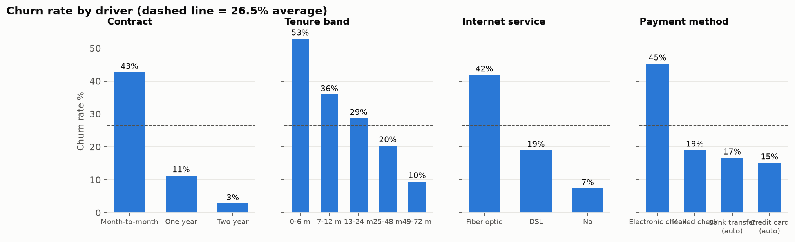
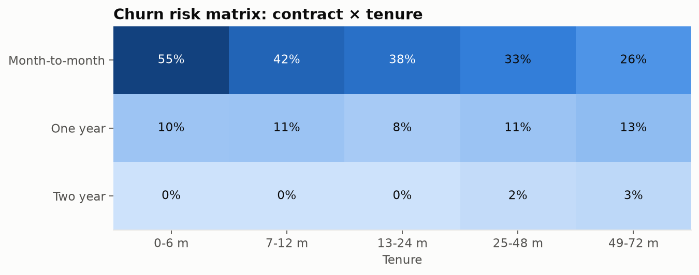
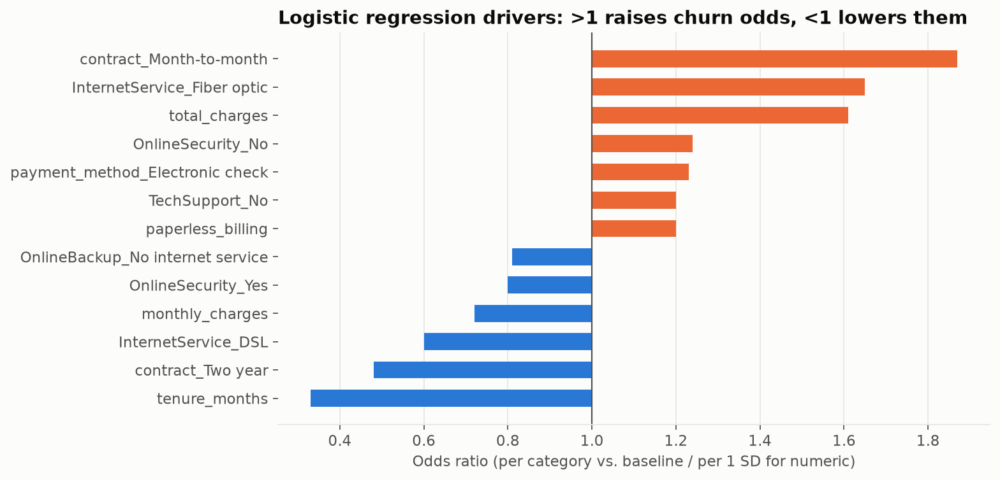
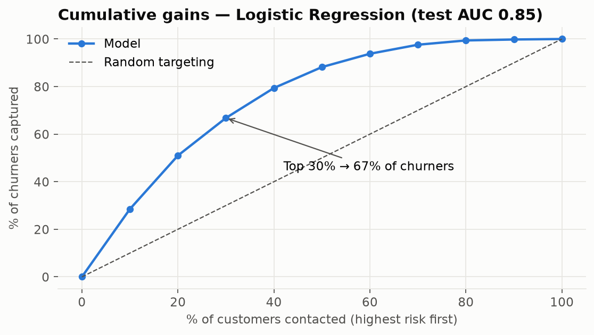

# 📉 Telecom Customer Churn Analytics: Drivers, Revenue at Risk & Prediction

**▶ Live interactive dashboard:** https://pragati-gautam14.github.io/telecom-customer-churn-analytics/

A telecom company is losing **26.5% of its customers** and **$139K of monthly recurring revenue**. This project finds *why* customers leave, checks the drivers with statistical tests, and builds a churn-prediction model that turns into a **ranked call list for the retention team**.

**Stack:** SQL (DuckDB) · Python (pandas, SciPy, scikit-learn) · Matplotlib / Plotly · Jupyter · Power BI (DAX)

---

## 📌 Key findings

| Area | Finding | Recommendation |
|---|---|---|
| Revenue impact | Churn = **$139K MRR (30.5% of MRR), ≈ $1.67M a year**. Churners pay more ($74 vs $61 a month) | Track **revenue churn**, not just the customer churn count |
| Contract | Month-to-month churn **43%** vs **3%** on two-year contracts; **89% of churners** are month-to-month | Discounted annual-upgrade offers |
| Tenure | **53%** of customers in their first 6 months churn | Onboarding journey + 30/60/90-day check-ins |
| Highest-risk segment | Month-to-month + Fiber + E-check: **1,307 customers, 60% churn**, $68K MRR lost | Priority segment for intervention |
| Product | Fiber churn 42% vs DSL 19%; no tech support 42% vs 15% with it | Investigate fiber quality and price; bundle tech support and security |
| Payment | Electronic check churn **45%** vs 15–17% on autopay | Autopay migration incentive |
| Model | Logistic regression **AUC 0.85**; contacting the **top 30%** by risk reaches **67% of churners** (2.2× random) | Use the exported risk-ranked list |






## 🔬 Method

1. **SQL modelling** (`sql/`): cleaning (11 blank `TotalCharges` for tenure-0 customers → 0), feature engineering (tenure bands, add-on count), churn and revenue KPIs, a long-format `churn_by_dimension` table, a contract × tenure risk matrix and top-risk segment combinations, using CTEs, `FILTER` aggregates and window shares.
2. **Statistical testing** (`src/churn_model.py`): chi-square tests with Cramér's V for categorical drivers, and Mann-Whitney U for tenure and charges. Gender is *not* significant.
3. **Modelling**: one-hot + scaling pipeline. Logistic regression (class-balanced, interpretable odds ratios) vs gradient boosting. Stratified split and 5-fold CV. Both reach AUC ≈ 0.85; logistic regression is kept for interpretability and higher recall (0.80).
4. **Actionability**: decile gains/lift table, risk tiers for active customers, and a top-500 call list.

| Model | CV AUC | Test AUC | Precision | Recall | F1 |
|---|---|---|---|---|---|
| Logistic Regression | 0.844 | 0.846 | 0.521 | 0.797 | 0.630 |
| Gradient Boosting | 0.845 | 0.846 | 0.665 | 0.501 | 0.571 |

> Note: risk scores come from a class-balanced model, so use them to **rank** customers. They are not calibrated probabilities.

## 📂 Structure
```
├── data/raw/telco_customer_churn.csv
├── sql/01_clean.sql, 02_churn_kpis.sql
├── src/run_pipeline.py      # SQL → tables
├── src/churn_model.py       # stats tests + models + scoring
├── src/build_report.py      # charts + docs/index.html
├── notebooks/analysis.ipynb # narrated walkthrough
├── outputs/tables/          # results incl. retention_target_list_top500.csv
├── powerbi/                 # clean data, risk scores, DAX measures
└── docs/index.html          # interactive dashboard (GitHub Pages)
```

## ▶️ Run

> ⚙️ **Automated:** the full pipeline (SQL models → analysis → charts → notebook → dashboard) re-runs on **GitHub Actions** (`.github/workflows/build.yml`) whenever `sql/` or `src/` changes.

```bash
pip install -r requirements.txt
python src/download_data.py
python src/run_pipeline.py && python src/churn_model.py && python src/build_report.py
```

**Dataset:** [IBM Telco Customer Churn](https://github.com/IBM/telco-customer-churn-on-icp4d) (IBM sample data).
